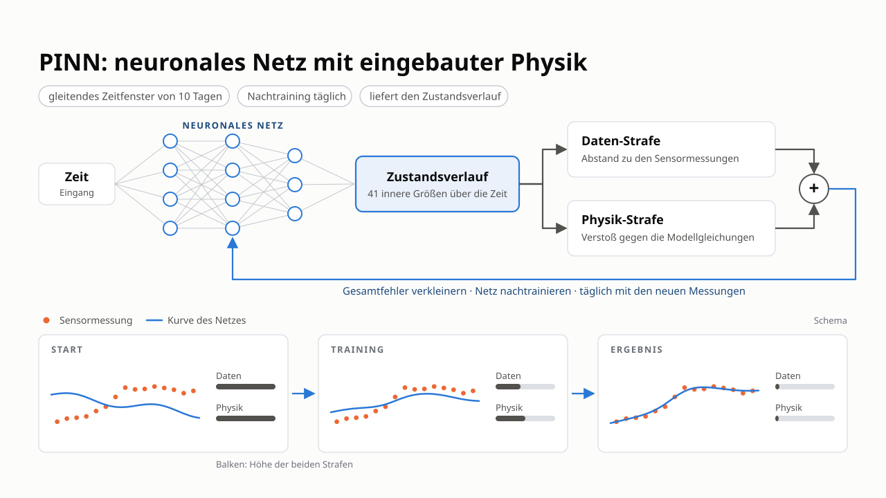

# PINN v2 — das Kollokations-Trajektorien-PINN

Diese Seite erklärt das physik-informierte neuronale Netz des Repositorys in
seinem heutigen Stand: **PINN v2**, ein Trajektoriennetz, das am
ADM1da-Residuum an Kollokationspunkten trainiert und kausal in einem
gleitenden Fenster betrieben wird. Der GRU-Observer (PINN B) hat eine
[eigene Seite](observer.md).

!!! abstract "In einem Satz"
    Das Netz *ist* die Zustandstrajektorie: $\hat{x}(t) = \exp(\mu + \sigma\, z_\theta(t, u))$.
    Es wird so trainiert, dass es **die Sensorwerte** über das Messmodell
    **trifft** und an frei gewählten Zeitpunkten **die ADM1da-Gleichungen
    erfüllt**; die bekannte Fütterung $u$ ist Eingang.

*PINN v2 im Überblick: Das Netz bildet Zeit und Fütterung auf den Verlauf der 41
Zustände ab; das Training verkleinert eine Daten-Strafe (Abstand zu den
Sensormessungen) plus eine Physik-Strafe (Verstoß gegen die Modellgleichungen),
und das Netz wird täglich auf einem gleitenden 10-Tage-Fenster nachtrainiert.*

Abschnitte 1–3 sind die Idee, Abschnitt 4 der Loss, Abschnitt 5 der kausale
Betrieb, Abschnitt 6 die Ergebnisse der Strukturstudie, Abschnitt 7 die
Code-Landkarte.

---

## 1. Das Problem und die zwei Wege

Ein Fermenter hat **41 ADM1da-Zustände**; online sehen wir fünf Signale
(Gasfluss, Methan, CO₂, pH, Trockensubstanz). Der UKF löst das rekursiv mit dem
ADM1da als Prädiktionsmodell. Ein PINN geht den umgekehrten Weg: Es schreibt die
ganze Trajektorie als Netz und nutzt die Physik als *weiche Nebenbedingung*.

Daraus folgen zwei Eigenschaften:

* **Weiche Physik.** Die Gleichungen sind ein Strafterm, das Netz kann also  
  Modellfehler gegen Datenanpassung abwägen. Das ist eine Stärke, wenn das
  Modell falsch ist, und eine Schwäche, wenn die Daten den Zustand nicht
  festlegen.
* **Fit je Reihe.** Über Reihen hinweg wird nichts gelernt. Was das Netz über  
  die Kinetik weiß, muss es aus dem Fenster ableiten, das es sieht. Der
  Benchmark stört 26 Kinetikkonstanten je Reihe ($\sigma = 0{,}25$, lognormal),
  und ein Fenster mit fünf Sensoren kann sie nicht identifizieren. Das ist die
  Grenze dieses Ansatzes, gemessen in Abschnitt 6.

---

## 2. Das Netz

`TrajectoryNet` (`pinn/model.py`) bildet die normierte Zeit plus
**Fütterungsmerkmale** auf den Zustand ab:

$$
\hat{x}(t) = \exp\big(\mu + \sigma \odot z_\theta(\tilde t,\ \phi(u, t))\big),
$$

* $\mu, \sigma$ — Mittelwert und Streuung von $\log x$ je Zustand auf dem  
  **Trainings-Split** (`train_split_log_stats`), die Ausgabenormierung sieht
  also nie die Wahrheit der bewerteten Reihe. Die Exponentialfunktion hält
  jeden Zustand positiv.
* $\tilde t$ — auf das Fenster skalierte Zeit, optional in $K$ deterministische  
  Fourier-Paare $(\sin 2\pi k \tilde t, \cos 2\pi k \tilde t)$ entwickelt
  (`ArchConfig.fourier_features`). Das ist der einzige Strukturhebel, der
  messbar geholfen hat (Abschnitt 6).
* $\phi(u, t)$ — die aktuelle Fütterung oder zusätzlich Tages- bzw.  
  Wochenmittel der Vergangenheit (`feed_mode = "current" | "hist7" | "hist30"`).
* Rumpf: `depth` tanh-Schichten mit je `width` Neuronen; Layer-Norm,  
  Residualblöcke, das „modified MLP“ und Ausgabeköpfe je Zustand sind als
  Optionen vorhanden und getestet.

**Closure.** Standardmäßig sagt das Netz nur die **31 Kernzustände** voraus.
Die sechs Ionenspezies folgen aus den Säure-Base-Gleichgewichten und der
Ladungsbilanz (`solve_charge_balance`, ein Newton-Verfahren für $S_{H^+}$), die
vier Gaspartialdrücke aus dem quasi-stationären Gasraum (`close_state`). Beide
Closures sind differenzierbar, und die Raten der geschlossenen Zustände kommen
aus einem Jacobi-Vektor-Produkt im Vorwärtsmodus (`close_state_with_rates`), das
Residuum unten ist also exakt. Der alternative „DAE-Modus“ sagt alle 41
Zustände voraus und hängt die sechs Gleichgewichtsresiduen als algebraische
Zeilen an.

---

## 3. Die Physikseite

`ADM1Physics` (`pinn/physics.py`) wertet die rechte Seite des ADM1da für einen
*Batch* von Zeitpunkten mit *unterschiedlicher* Fütterung aus. Sie nutzt
denselben differenzierbaren Kern `pyadm1.core.adm1_torch.adm1da_rhs_torch` wie
das Torch-Backend des UKF und der GRU-Observer; eine getestete
Implementierung der Gleichungen bedient also alle Schätzer.

* `InfluentModel` macht aus der Fütterung $u$ [m³/d je Substrat] mit reiner  
  Array-Algebra $(q_{ad}, s_{in})$. Der Modus `"nominal_mix"` bildet nach, wie
  die Benchmark-Wahrheit erzeugt wurde (Zusammensetzung aus der Nominalmischung,
  Gesamtfluss aus der Fütterung); `"blend"` ist die physikalisch richtige
  flussgewichtete Mischung für Anlagen mit wirklich wechselnder Zusammensetzung.
* `build_params` friert die Anlagenparameter ein, optional mit den wahren  
  Kinetikfaktoren der Reihe (nur zur Verifikation — ein PINN im Feld hat das
  Nominalmodell).
* Die Residuumszeilen sind die Kernzustände ohne die schnellen gelösten Gase  
  $S_{h2}, S_{ch4}$; die Zeilen von $S_{co2}$ und $S_{nh4}$ werden als
  Erhaltungssummen $S_{co2}+S_{hco3}$ und $S_{nh4}+S_{nh3}$ gebildet, was die
  steifen Säure-Base-Raten exakt entfernt (`acid_base = "sum"`).

`trajectory_residual` verifiziert die Physik am Simulator: Das Residuum der
Benchmark-Wahrheit mit den wahren Parametern liegt auf dem Niveau des
Differenzenfehlers (getestet in `tests/test_pinn_physics.py`).

---

## 4. Der Loss

Für ein Fenster $[0, t_{obs}]$ mit Sensorwerten $y_k$ zu den Stunden $t_k$ und
Kollokationspunkten $\tau_m$ (zufällig in $[0, t_{obs} + \text{Horizont}]$):

$$
\mathcal L = \underbrace{\frac1K\sum_k \Big\lVert \frac{h(\hat x(t_k)) - y_k}{\sigma_y}\Big\rVert^2}_{\text{Daten}}
\;+\; \lambda\ \underbrace{\frac1M\sum_m \Big\lVert \frac{\dot{\hat x}(\tau_m) - f(\hat x(\tau_m), u(\tau_m))}{\sigma_r}\Big\rVert^2}_{\text{Physik}} .
$$

* $h$ ist das differenzierbare Messmodell (`MeasurementModel`: Gasflüsse aus dem  
  quasi-stationären Gasraum, pH aus der Ladungsbilanz, TS aus den
  Partikulärfraktionen), $\sigma_y$ das Sensorrauschen des Datensatzes.
* $\dot{\hat x}$ ist die exakte Zeitableitung des Netzes (Autograd).
* $\sigma_r$ ist eine **Residuumsskala je Zeile**, auf Trainingsdaten gefittet  
  (`fit_scale`), entweder die typische Größe der Nettorate (`"rate"`) oder eine
  Jacobi-basierte Skala (`"jacobian"`, Standard beim PINN). Ohne sie dominieren
  die steifen Zeilen und die langsamen, informativen Zeilen gehen unter.
* $\lambda$ steigt in den ersten 20 % der Schritte linear an  
  (`lambda_warmup_frac`); Adam mit Kosinus-Abfall, optional L-BFGS zum Schluss.

Untersuchte und in `TrainConfig` erhaltene Varianten: Training auf den wahren
Zuständen statt auf Messungen (`data_source`), ein Anfangswert-Prior aus dem
Anlagen-Warm-up (`ic_prior`), kausale Kollokationsgewichtung (`causal_eps`),
Time-Marching, ein inverser Modus, der die Kinetikfaktoren lernt
(`estimate_kinetics`), und eine additive gelernte Korrektur des Physik-Residuums
(Option `greybox`, `RateCorrection` in `pinn/train.py`).

---

## 5. Kausaler Betrieb: das gleitende Fenster

Ein Trajektoriennetz ist ein Glätter: Es sieht das ganze Fenster. Im Betrieb
kann es nicht in die Zukunft sehen, deshalb betreibt `pinn/rolling.py` es
**kausal**: Alle `cadence_hours` (24 h) wird das Netz auf den letzten
`window_days` Messungen nachtrainiert, warm gestartet mit den vorigen Gewichten
(`steps_warm = 200` statt 3000 von Grund auf). Das beste Fenster der Studie sind
10 Tage, und diese Einstellung nutzt die Registry; längere Fenster und häufigeres
Nachtrainieren helfen nicht. Zwischen zwei Nachtrainings wird die Schätzung der
aktuellen Stunde überbrückt, entweder durch Halten des letzten Werts (`"hold"`)
oder durch Vorwärtsintegration des nominalen ADM1da mit der bekannten Fütterung
(`"adm1"`). Halten ist 0,8 Punkte besser, weil die Nominalkinetik binnen eines
Tages vom wahren Zustand wegdriftet. Dieselbe Kette liefert auch
Fixed-Lag-Schätzungen (der Wert, den ein späteres Nachtraining einer früheren
Stunde zuweist, Schlüssel `"lag1"` und `"lag3"`); sie sind etwas genauer, aber
einen bzw. drei Tage verspätet.

Kosten: Eine 60-Tage-Reihe braucht auf der CPU einige zehn Minuten. Darum
bleibt der UKF der operative Schätzer und das PINN ein Studienobjekt.

---

## 6. Ergebnisse der Strukturstudie

Zwanzig Testreihen, 60 Tage, Benchmark-Metrik (Median-NRMSE über die
Zustände). Details und Statistik stehen im Architekturbericht
(`PyADM1ODE_estimate_local/experiments/pinn_architecture_study`). Die
Strukturstudie fittet je Reihe ein Netz auf den ganzen 60-Tage-Messverlauf
(offline) und bewertet alle 60 Tage; die kausale Studie bewertet ab Tag 3, weil
das gleitende PINN in den ersten Tagen auf der Prior-Mitte läuft.

| Einstellung | UKF | PINN v2 |
| --- | --- | --- |
| offline, beste Struktur (Tiefe 4, Breite 128, tanh, 4 Fourier-Paare), 60 d | 15,1 % | **18,3 %** |
| offline, Spanne über alle getesteten Strukturen, 60 d | 15,1 % | 18,3 – 24,4 % |
| kausal, 10-Tage-Fenster, tägliches Nachtraining, Halten, ab Tag 3 | 14,2 % | **18,6 %** |
| kausal, dieselbe Kette mit einem Tag Nachlauf, ab Tag 3 | 14,2 % | 18,3 % |

* **Der einzige Hebel, der hilft, ist die Fourier-Zeitkodierung**  
  (Haupteffekt etwa −1 Punkt). Tiefe, Breite, Aktivierung, Layer-Norm,
  Residualblöcke, Fütterungshistorie, Ausgabeköpfe je Zustand: innerhalb des
  Seed-Rauschens.
* Der Offline-Abstand zum UKF (3,3 Punkte, $p = 0{,}064$) ist eine Lücke aus  
  **Modellfehler und Identifizierbarkeit**, keine Kapazitätslücke: Das Netz
  kann die Kinetik der Reihe nicht aus fünf Sensoren lernen, und die weiche
  Physik lässt es dort driften, wo die Daten es nicht festhalten. Kausal
  betrieben bleibt jedes Schema signifikant hinter dem UKF ($p \le 0{,}005$).
* Das PINN als Pseudomessung oder mit festem Gate in den UKF zu fusionieren  
  (Blöcke F1–F4) bringt etwa einen Punkt, nicht signifikant.

Die bindende Grenze ist damit der Modellfehler der Kinetik, nicht das Netz.

---

## 7. Code-Landkarte

| Modul | Inhalt |
| --- | --- |
| `pinn/data.py` | `BenchmarkSeries` (aus dem gemeinsamen `Series` von `filter_tuning.datasets.load_benchmark`), Fütterungs-Lookup und -Historie, Prioren aus dem Trainings-Split |
| `pinn/influent.py` | `InfluentModel`: Fütterung → $(q_{ad}, s_{in})$, gebatcht |
| `pinn/physics.py` | `ADM1Physics`, Closures, `PhysicsConfig`, `trajectory_residual`, `build_params` |
| `pinn/measure.py` | `MeasurementModel`, `SensorNoise` aus `meta.json` |
| `pinn/model.py` | `TrajectoryNet`, `ArchConfig` |
| `pinn/train.py` | `TrainConfig`, `train_trajectory`, Metriken und Berichtsformatierung |
| `pinn/rolling.py` | `RollingConfig`, `run_rolling`, ADM1-Überbrückung |
| `pinn/kinetics.py` | lernbare Kinetikfaktoren (inverses PINN) |
| `estimators.py` | `"pinn"` in der [Schätzer-Registry](../usage/estimators.md): `PinnEstimator.run(series)` |

Experimente: `experiments/pinn_v2/` (Architektur-Sweep, Rolling-Sweep,
Fusionsregeln, Lag-Bericht).

## Literatur

* Raissi, M., Perdikaris, P. & Karniadakis, G. E. (2019). *Physics-informed  
  neural networks.* Journal of Computational Physics 378:686–707.  
* Wang, S., Sankaran, S. & Perdikaris, P. (2022). *Respecting causality is all  
  you need for training physics-informed neural networks.* arXiv:2203.07404.  
* ADM1da-Modell und Zustandsindizes: [ADM1da-Modell](adm1.md).  

## API-Referenz

::: pyadm1ode_estimation.estimation.pinn.physics.ADM1Physics
    options:
      show_root_heading: true
      show_source: false
      heading_level: 3

::: pyadm1ode_estimation.estimation.pinn.model.TrajectoryNet
    options:
      show_root_heading: true
      show_source: false
      heading_level: 3

::: pyadm1ode_estimation.estimation.pinn.rolling.run_rolling
    options:
      show_root_heading: true
      show_source: false
      heading_level: 3
