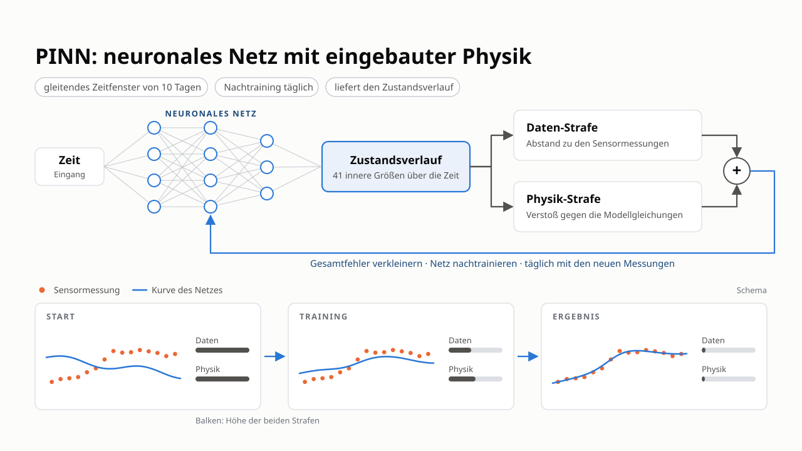

# PINN v2 — the collocation trajectory PINN

This page explains the physics-informed neural network of the repository as it
exists today: **PINN v2**, a trajectory network trained on the ADM1da residual
at collocation points and run causally in a rolling window. The GRU observer
(PINN B) has its [own page](observer.md).

!!! abstract "In one sentence"
    The network *is* the state trajectory: $\hat{x}(t) = \exp(\mu + \sigma\, z_\theta(t, u))$.
    It is trained to **fit the sensor readings** through the measurement model
    and to **satisfy the ADM1da equations** at freely chosen time points, with
    the known feed $u$ as input.

*PINN v2 at a glance (slide in German): the network maps time and feed to the
41-state trajectory; training minimises a data penalty (distance to the sensor
readings) plus a physics penalty (violation of the model equations), and the
network is retrained every day on a sliding 10-day window.*

Sections 1–3 are the idea, section 4 the loss, section 5 the causal operation,
section 6 what the structure study found, section 7 the implementation map.

---

## 1. The problem and the two routes

A digester has **41 ADM1da states**; online we see five signals (gas flow,
methane, CO₂, pH, total solids). The UKF solves this recursively with the ADM1da
as its prediction model. A PINN takes the opposite route: it writes down the
whole trajectory as a network and uses the physics as a *soft constraint*.

Two properties follow:

* **Soft physics.** The equations are a penalty, so the network can trade  
  model error against data fit. That is a strength when the model is wrong and a
  weakness when the data are too few to pin the state down.
* **Per-series fit.** Nothing is learned *across* series. Whatever the network  
  knows about kinetics it must infer from the window it sees. The benchmark
  perturbs 26 kinetic constants per series ($\sigma = 0.25$, lognormal), and a
  5-sensor window cannot identify them. That is the ceiling of this approach,
  measured in section 6.

---

## 2. The network

`TrajectoryNet` (`pinn/model.py`) maps normalised time plus **feed features**
to the state:

$$
\hat{x}(t) = \exp\big(\mu + \sigma \odot z_\theta(\tilde t,\ \phi(u, t))\big),
$$

* $\mu, \sigma$ — per-state mean / std of $\log x$ on the **training split**  
  (`train_split_log_stats`), so the output normalisation never sees the
  evaluated series' truth. The exponential keeps every state positive.
* $\tilde t$ — time scaled to the window, optionally expanded into $K$  
  deterministic Fourier pairs $(\sin 2\pi k \tilde t, \cos 2\pi k \tilde t)$
  (`ArchConfig.fourier_features`). This is the one structural knob that
  measurably helped (section 6).
* $\phi(u, t)$ — the current feed, or the current feed plus daily / weekly  
  history means (`feed_mode = "current" | "hist7" | "hist30"`).
* Body: `depth` tanh layers of `width` units; options for layer norm, residual  
  blocks, the "modified MLP" and per-state output heads exist and were tested.

**Closure.** By default the network predicts the **31 core states** only. The
six ion species follow from the acid–base equilibria and the charge balance
(`solve_charge_balance`, a Newton solve for $S_{H^+}$), the four gas pressures
from the quasi-steady headspace (`close_state`). Both closures are
differentiable, and the rates of the closed states come from a forward-mode
Jacobian-vector product (`close_state_with_rates`), so the residual below is
exact. The alternative "DAE mode" predicts all 41 states and adds the six
equilibrium residuals as algebraic rows.

---

## 3. The physics side

`ADM1Physics` (`pinn/physics.py`) evaluates the ADM1da right-hand side for a
*batch* of time points with *different* feeds. It shares the differentiable
core `pyadm1.core.adm1_torch.adm1da_rhs_torch` with the UKF's torch backend and
the GRU observer, so one tested implementation of the equations serves all
estimators.

* `InfluentModel` turns the feed $u$ [m³/d per substrate] into $(q_{ad}, s_{in})$  
  with plain array algebra. Its `"nominal_mix"` mode reproduces how the
  benchmark truth was generated (composition from the nominal mix, total flow
  from the feed); `"blend"` is the physically correct flow-weighted blend for
  plants whose composition really varies.
* `build_params` snapshots the plant's parameters, optionally with the series'  
  true kinetic factors (for verification only — a field PINN has the nominal
  model).
* The residual rows are the core states except the fast dissolved gases  
  $S_{h2}, S_{ch4}$; the rows of $S_{co2}$ and $S_{nh4}$ are formed as the
  conserved sums $S_{co2}+S_{hco3}$ and $S_{nh4}+S_{nh3}$, which removes the
  stiff acid–base rates exactly (`acid_base = "sum"`).

`trajectory_residual` verifies the physics against the simulator: the residual
of the benchmark truth with the true parameters is at the finite-difference
error level (tested in `tests/test_pinn_physics.py`).

---

## 4. The loss

For a window $[0, t_{obs}]$ with sensor readings $y_k$ at hours $t_k$ and
collocation points $\tau_m$ (random in $[0, t_{obs} + \text{horizon}]$):

$$
\mathcal L = \underbrace{\frac1K\sum_k \Big\lVert \frac{h(\hat x(t_k)) - y_k}{\sigma_y}\Big\rVert^2}_{\text{data}}
\;+\; \lambda\ \underbrace{\frac1M\sum_m \Big\lVert \frac{\dot{\hat x}(\tau_m) - f(\hat x(\tau_m), u(\tau_m))}{\sigma_r}\Big\rVert^2}_{\text{physics}} .
$$

* $h$ is the differentiable measurement model (`MeasurementModel`: gas flows  
  from the quasi-steady headspace, pH from the charge balance, TS from the
  particulates), $\sigma_y$ the dataset's sensor noise.
* $\dot{\hat x}$ is the exact time derivative of the network (autograd).
* $\sigma_r$ is a **per-row residual scale** fitted on training data  
  (`fit_scale`), either the typical size of the net rate (`"rate"`) or a
  Jacobian-based scale (`"jacobian"`, the default for the PINN). Without it the
  stiff rows dominate and the slow, informative rows are ignored.
* $\lambda$ ramps up linearly over the first 20 % of the steps  
  (`lambda_warmup_frac`); Adam with cosine decay, optional L-BFGS polish.

Variants studied and kept as options in `TrainConfig`: training on the true
states instead of measurements (`data_source`), an initial-condition prior from
the plant warm-up (`ic_prior`), causal collocation weighting (`causal_eps`),
time marching, an inverse-PINN mode that learns the kinetic factors
(`estimate_kinetics`) and an additive learned correction of the physics residual
(option `greybox`, `RateCorrection` in `pinn/train.py`).

---

## 5. Causal operation: the rolling window

A trajectory network is a smoother: it sees the whole window. In operation it
cannot see the future, so `pinn/rolling.py` runs it **causally**: every
`cadence_hours` (24 h) the network is retrained on the last `window_days` of
measurements, warm-started from the previous weights (`steps_warm = 200`
instead of 3000 from scratch). The study's best window is 10 days, which is
what the registry uses; longer windows and more frequent retraining do not
help. Between two retrainings the estimate at the current hour is bridged,
either by holding the last value (`"hold"`) or by integrating the nominal
ADM1da forward from it with the known feed (`"adm1"`). Holding is 0.8 points
better, because the nominal kinetics drift away from the true state within a
day. The same chain also yields fixed-lag estimates (the value a later
retraining assigns to an earlier hour, keys `"lag1"` and `"lag3"`), which are
slightly more accurate but one or three days late.

Cost: one 60-day series takes tens of minutes on a CPU, which is why the UKF
remains the operational estimator and the PINN a study object.

---

## 6. What the structure study found

Twenty test series, 60 days, benchmark metric (median-over-states NRMSE).
Details and statistics are in the architecture report
(`PyADM1ODE_estimate_local/experiments/pinn_architecture_study`). The structure
study fits one network per series to the whole 60-day measurement record
(offline) and scores all 60 days; the causal study scores from day 3 on,
because the rolling PINN runs on the prior mean for its first days.

| Setting | UKF | PINN v2 |
| --- | --- | --- |
| offline, best structure (depth 4, width 128, tanh, 4 Fourier pairs), 60 d | 15.1 % | **18.3 %** |
| offline, range over all tested structures, 60 d | 15.1 % | 18.3 – 24.4 % |
| causal, 10-day window, daily retraining, hold, from day 3 | 14.2 % | **18.6 %** |
| causal, same chain with one day lag, from day 3 | 14.2 % | 18.3 % |

* **The only lever that helps is the Fourier time encoding** (main effect about  
  −1 point). Depth, width, activation, layer norm, residual blocks, feed
  history, per-state heads: inside the seed noise.
* The offline gap to the UKF (3.3 points, $p = 0.064$) is a  
  **model-error / identifiability** gap, not a capacity gap: the network cannot
  learn the series' kinetics from five sensors, and the soft physics lets it
  drift where the data do not pin it. Run causally, every scheme stays
  significantly behind the UKF ($p \le 0.005$).
* Fusing the PINN into the UKF as a pseudo-measurement or with a fixed gate  
  (blocks F1–F4) gains about one point, not significant.

The binding constraint is therefore the kinetic model error, not the network.

---

## 7. Implementation map

| Module | Contents |
| --- | --- |
| `pinn/data.py` | `BenchmarkSeries` (built from the shared `Series` of `filter_tuning.datasets.load_benchmark`), feed lookup and history features, training-split priors |
| `pinn/influent.py` | `InfluentModel`: feed → $(q_{ad}, s_{in})$, batched |
| `pinn/physics.py` | `ADM1Physics`, closures, `PhysicsConfig`, `trajectory_residual`, `build_params` |
| `pinn/measure.py` | `MeasurementModel`, `SensorNoise` from `meta.json` |
| `pinn/model.py` | `TrajectoryNet`, `ArchConfig` |
| `pinn/train.py` | `TrainConfig`, `train_trajectory`, metrics and report formatting |
| `pinn/rolling.py` | `RollingConfig`, `run_rolling`, ADM1 bridging |
| `pinn/kinetics.py` | learnable kinetic factors (inverse PINN) |
| `estimators.py` | `"pinn"` in the [estimator registry](../usage/estimators.md): `PinnEstimator.run(series)` |

Experiments: `experiments/pinn_v2/` (architecture sweep, rolling sweep, fusion
rules, lag report).

## References

* Raissi, M., Perdikaris, P. & Karniadakis, G. E. (2019). *Physics-informed  
  neural networks.* Journal of Computational Physics 378:686–707.  
* Wang, S., Sankaran, S. & Perdikaris, P. (2022). *Respecting causality is all  
  you need for training physics-informed neural networks.* arXiv:2203.07404.  
* ADM1da model and state indices: [ADM1da model](adm1.md).  

## API reference

::: pyadm1ode_estimation.estimation.pinn.physics.ADM1Physics
    options:
      show_root_heading: true
      show_source: false
      heading_level: 3

::: pyadm1ode_estimation.estimation.pinn.model.TrajectoryNet
    options:
      show_root_heading: true
      show_source: false
      heading_level: 3

::: pyadm1ode_estimation.estimation.pinn.rolling.run_rolling
    options:
      show_root_heading: true
      show_source: false
      heading_level: 3
